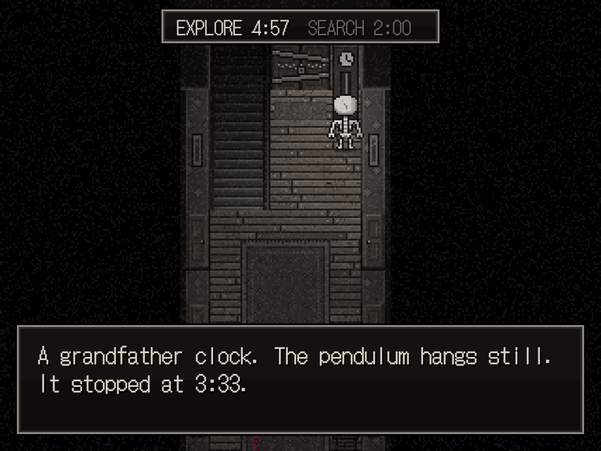
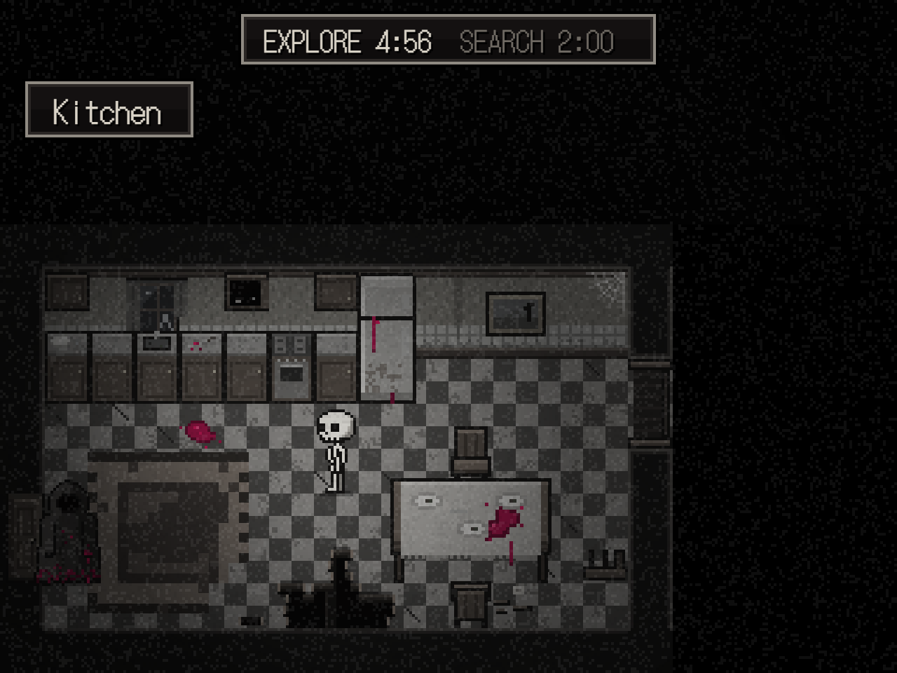

# Enchanted

An RPG Maker style horror game made with PixiJS, packaged as a Windows app with Electron.

| | |
| --- | --- |
|  |  |

## Install
```
Click here to install the game https://github.com/ninchzy/Enchanted_full_game/releases/tag/v0.1.0
```

## Run

```
npm install
npm run dev
```

Then open http://localhost:5173.

### The desktop app

Enchanted ships as a Windows app (Electron, `electron/main.cjs`). The editor is left out of it.

```
npm run app     # build the game and open it in the app window
npm run dist    # make the files to share, in release/desktop/
```

`npm run dist` makes two files:

- `Enchanted Setup <version>.exe`: installs the game with Start menu and desktop shortcuts.
- `Enchanted <version> (portable).exe`: a single file that runs without installing.

The game always starts fullscreen; F11, Alt+Enter or Settings → Fullscreen switches to a window (3x, 960x720, resizable) and back. The app serves the built game from `app://enchanted/`, since module scripts and `fetch` don't work from plain files.

The icon is the skeleton's skull (`SKULL_FRONT` in `src/gfx/characters.js`). `npm run icon` redraws `build/icon.png` and `build/icon.ico` from it; run it again after changing the skull.

The app is unsigned, so the first launch on another PC may show "Windows protected your PC": click "More info", then "Run anyway".

The older browser build (`release-files/`: `Play.bat` serves `dist` at http://localhost:8765/) still works if you put `dist` next to those files as `game`.

## Controls

| Key | Action |
| --- | --- |
| W A S D (or arrows) | walk / move the cursor |
| Shift (held) | run |
| SPACE | interact, advance text (only SPACE does), confirm |
| TAB | open / close the inventory |
| ESC | back out of a menu; in game, opens the ESC menu (not during cutscenes) |

In the inventory, the line at the bottom describes the selected item; that is all the text an item has. SPACE on a white item offers **Use**, which tries it on whatever the skeleton is facing. Items that can't be used (`usable: false` in `src/items.js`, e.g. the pocket watch) are listed in blue-grey and SPACE does nothing, unless they have a `note` to read: then **Inspect** shows it on a piece of paper in the middle of the screen (the poem).

## Title screen and saving

The game opens on the title with a pulsing "Press SPACE to continue". SPACE (or a click) clears the text and shows **New Game**, **Continue**, **Settings** and **Exit** at the bottom; ESC goes back to the title. Continue is greyed out until a save exists; it opens the list of save files (8 slots, three on screen at a time: it scrolls with W/S or the mouse wheel, and the header shows which ones you're looking at), each showing the room and the time played. **Exit** closes the app (in a browser it does nothing).

You can only save at the **open book on the lectern** on the upper floor (against the right wall of the landing), and only while he isn't searching; during a search the book says "I don't have time for that right now." SPACE on it opens the save files: an empty slot is saved straight away; a used one darkens the screen and asks "Override this slot?" (No is selected by default).

ESC in game opens the ESC menu (`src/ui/pause.js`): a black screen like the title with **Back**, **Load Save**, **Settings** and **Exit Game** in the middle, while the game and the clock wait. It never opens during a cutscene or while a text box is up. Load Save opens the save files (greyed out when there are none) and asks "Load this file? All unsaved progress will be lost." before loading; Exit Game asks "Are you sure? All unsaved progress will be lost." in the same black style (No by default), and Yes returns to the title screen. ESC backs out of each.

**Settings** (`src/ui/settings.js`, from the title screen or the ESC menu): Fullscreen (On / Off), Master volume, Music and Sound effects, each in 10% steps. W/S choose, A/D change (SPACE also flips Fullscreen), ESC or Back closes; the mouse works too. Changing the music volume plays a moment of the music if none is on; the other two play a footstep. The volumes are kept in localStorage (`skeleton-house:volume`) (fullscreen is the same switch as F11, and every launch starts fullscreen again). Music is every looping track except the portal's hum; everything else is a sound effect (`musicBus` / `sfxBus` in `src/audio.js`). These sit on top of the editor's volumes. After a game over, Restart loads the last file you saved to or loaded this session (or starts a new game if there is none).

Saves live in localStorage (`skeleton-house:save:1..8`; `SLOTS` in `src/saves.js`). In the desktop app that is in `%APPDATA%\Enchanted`, kept across updates and reinstalls. In a browser they belong to that browser, and saves from the browser version don't carry over to the app. `src/saves.js` reads and writes them; the title text is `GAME_TITLE` in `src/config.js`.

## The opening (new game)

New Game plays the intro (`src/cutscene/intro.js`) with no timers until it ends:

1. Black screen, the "first cutscene" track looping. *murmuring* / *distant chanting*.
2. In the summoning room (only the candles and pentagram are shown; the mannequin is swapped for the pile of bones with him kneeling behind it), the candles light one by one, then the chanting (Zalgo text in the blood colour); the ritual sound repeats every 6 seconds; the pentagram lights up; the bones pulse white and grow until the screen is white, timed so the magical barrier sound ends exactly then. All sound cuts, white fades to black.
3. "Ow, my head" on black, then the spare bedroom with the background music. Objects only answer "I should find out where I am first." until you leave the room.
4. In the hallway the camera pans up, he steps out of the kitchen, talks, the camera pans back. Walk up to him and press SPACE: the (placeholder) conversation, then the pocket watch. A fade to black puts him by the front door and the game (and the timers) begin.

Text colours: the skeleton speaking out loud is sand, him blue-grey, thoughts and narration white (`VOICE` in `src/ui/common.js`). A found item is announced with `game.giveItem(id)`: "New item added to inventory: **item**!" with the name in bold yellow.

The script runs on `Director` (`src/cutscene/director.js`): `wait`, `tween`, `until`, `say`, `repeat`, all on the game clock; ESC → Exit Game during the free-walking parts cancels it cleanly.

**Rules for every cutscene** (`game.runScene` applies them to any scripted scene): the timers are hidden and the clock waits; at the end the screen fades to black, the timers come back, and it fades in again (a scene that already ends on black just fades in).

## Sound

Files live in `/sounds` and are wired up in `src/audio.js` (`FILES`). The background music and the cutscene track loop without a gap: each repeat starts while the previous copy is still fading out (`LOOPS` sets where). The music plays from waking up onwards and from any loaded save, drops to 50% while he searches, and stops on game over and on the title screen. A map can have its own track (`music: 'ritualRoom'` in the summoning room and the hidden cellar): walking in crossfades from the background music to it and back out again. That track is 0:44–2:44 of "summoning room and hidden room", cut into its own file by `node tools/cut-loop.mjs <in.wav> <out.wav> 44 120` so it loops seamlessly (run it again if you replace the recording). Doors use the 4th sound in "opening door (4).wav" (offset in `RECORDED`). **Item descriptions:** the editor's "Item descriptions" section has a text box for each item's inventory line (↺ puts the original back); Save writes the changed ones to `src/item-texts.json`, which overrides the text in `src/items.js`.

**Volumes:** the editor's "Sound volumes" section has a slider (0–200%, 100% = as recorded) and a ▶ preview for every sound plus a master volume; music follows the slider live, double-click a slider to reset it, and Save writes `src/sound-volumes.json` (only sounds not at 100%). They apply on top of the game's own levels, e.g. the music still halves while he searches. Footsteps come from "walking.mp3": its two steps alternate, one per tile, sped up 15% for the skeleton and slowed down 15% (deeper) for him. Rummaging and his groan are still synthesised placeholders.

## Hiding spots

An object with `hide: true` is a hiding spot. SPACE on it offers **Investigate** (shows its text as usual) or **Hide**, which asks "Hide inside the wardrobe?" with Yes / No. While hiding, the skeleton is invisible and can't move; nothing on screen says where he is. SPACE brings him back out on the tile he hid from.

The wording (inside / under / behind) is picked from the object type in `src/hiding.js`; `hide: "under the sink"` overrides it. While hidden, `game.hidden` holds the spot's tile (`x`, `y`), its key and type, which is what an enemy will check later (`game.isHidden()`). In the editor, tick **Hiding spot** on any object; with the Collision overlay on, hiding spots show in green.

## The hooded figure (seeker)

The game runs in rounds, shown at the top middle of the screen:

1. **Explore (5:00):** the player roams; the hooded figure stands frozen where he last stopped.
2. **Search (2:00):** he walks through the house (also where you can't see him) and checks 10 random hiding spots in a random order (a new draw every search). If he opens the one you are in, you're found. He walks 10% slower than the skeleton.
3. After 5 rounds he walks to the bedroom and **sleeps (10:00)**, then wakes with a groan and searches again. Then it all starts over.

- If you hid during a search and he didn't find you, he remembers the first spot you used that turn and checks it first next time, on top of his 10.
- Standing next to him is safe while he stands frozen. During his search:
  - **Sight:** in the dark he only sees a little way: the tiles beside him, three wide for two tiles ahead, one more straight on (`SIGHT` in `src/seeker.js`, turned to where he faces; walls and furniture block it). If he sees you out of hiding, he **chases** you.
  - **Hearing:** running (Shift) is loud. In the same room he chases you straight away. From his floor's hub (the hallway, the landing, the attic, the passage, the yard) he knows exactly which room you ran in, also on the floor above or below. From another ground-floor room he can only tell roughly: the right room, or the one next to it on his side (both neighbours when level with it; from the far end, a sound by the stairs might also be upstairs). He goes and checks one random hiding spot in the room he picks (`guessRoom` in `src/acoustics.js`). Running in the backyard or the shed can't be heard from anywhere in the house.
  - **Chase:** he runs as fast as you walk, through doors too, with the chase music playing. Right next to you means caught ("He caught you."). Out of his room and more than 6 tiles away, you've lost him: he goes back to his search and the music drifts back. Hiding while he's still that close doesn't help: he heard where you went.
- When his search ends he steps out of the way: at least 4 tiles from doors, stairs and ladders; in the hallway two tiles further down against the nearest wall.
- The timers stop while you read an object's text or answer its prompt, until all of it is closed.
- Game over shows a Restart button (SPACE or click).

To test without waiting, shorten the phases in the address bar (seconds): `http://localhost:5173/?roam=20&seek=60&sleep=30`.

**Sounds** (placeholders made in code, `src/audio.js`): footsteps and doors for both of you, rummaging when he searches, a groan when he wakes. How loud his footsteps and doors are follows the floor plan (`src/acoustics.js`): rooms next to yours are loud, every room in between makes him quieter, and so does distance down the hallway. Nothing is heard from another floor, and the yard is only audible from the shed.

## In-game editor

Click the **EDITOR** tab on the right edge of the screen. The game freezes, lighting turns off so you can see everything, and a panel opens.

- **Select** an object by clicking it. Its collision/interaction tiles are highlighted.
- **Move**: drag it (snaps to tiles; hold Shift to move by single pixels), use the arrow keys, or type X / Y / Offset values.
- **Scale**: mouse wheel over the game, or the Scale slider.
- **Rotate**: Shift + mouse wheel, or the Rotate slider. **Flip** with the checkbox.
- **Turn (R)**: furniture such as wardrobes, bookshelves, dressers, shelves, counters, the fridge, the piano, the TV and trunks cycles between standing against the back wall (front view), the right wall and the left wall (side views), and the bottom wall (seen from above, showing its back). Press R while placing an object or with one selected, or use "Placed against". Other objects turn 90°.
- **Collision**: Default, Whole object blocks, Walk through, or **Custom box**. A custom box is a red rectangle of tiles counted from the object's X / Y: type its X / Y / W / H, or press "Move box with the mouse" and drag it in the game (Shift + drag resizes). The box is also where the object can be inspected from.
- **Draw order**: objects are drawn by how far down the screen they stand. "In front" / "Behind" puts the selected object in front of or behind everything it overlaps (e.g. a plant standing on a table); the number is the offset in pixels.
- **Interaction text**: type in the box. A blank line starts a new text box; empty means it can't be inspected.
- **Options (advanced)**: the object's look options as JSON, e.g. `{"kind": "corn"}` or `{"blood": true}`.
- **Add**: pick an object under "Add object", then click in the game to place it (hold Shift to place several).
- **Duplicate** (Ctrl+D), **Delete** (Del), **Reset** (back to the map file), **Undo / Redo** (Ctrl+Z / Ctrl+Y).
- **Map** dropdown jumps to any area. Right-drag moves the view. "All story states" also shows objects that only appear later (like the trapdoor).
- **Save** (Ctrl+S) writes the changes to `src/maps/edits/<map>.json`. A red dot on the tab means there are unsaved changes.

Saving needs `npm run dev` (the dev server writes the files). Edits sit on top of the map files: the `.js` maps are never rewritten, and deleting an edits file brings that map back to how the code has it. An edited object is matched to the map file by its type and original position (e.g. `bookshelf@2,2`), so if you later move it in the `.js` file itself, its old edits stop applying.

Characters (the skeleton, the cloaked figure) and doors aren't editable in the editor yet.

## How it's built

All art is drawn in code (no image files), so it can be tweaked by editing numbers:

- `src/gfx/palette.js`: the 70% grayscale look. Every color goes through `c()`; only `BLOOD` (Love Potion `#D11B5C` and darker shades of it) is left saturated.
- `src/gfx/characters.js`: the skeleton (player) and the cloaked figure (AI).
- `src/gfx/tiles.js`: floors, wallpaper, ceilings, stairs and holes in the floor.
- `src/gfx/props.js`: all furniture and decoration.
- `src/maps/*.js`: one file per room. A map is a grid of tile characters plus lists of props, doors and actors.
- `src/items.js`: the item database (names, the inventory line, icons).
- `src/puzzles.js`: where items are found and what using them does (see "Items around the house").

The game renders at 320x240 (20x15 tiles of 16px) and scales up by whole numbers to fit the window.

### Map tile legend

```
' ' black void        '#' ceiling / top of wall    'W' wall (style from theme.wall)
'L' 'R' hallway side walls                         '.' floor (style from theme.floor)
'x' broken boards (walkable)                       'o' hole (blocked)
'S' stairs up         'D' stairs down              'P' porch steps
'g' grass             ',' dirt path                's' garden soil
'p' porch deck        'F' porch front (blocked)    'f' fence   'q' collapsed fence (both blocked)
```

A door is a trigger tile: `{ x, y, to: 'mapId', at: [x, y, 'facing'] }`. Walking into it fades to black and moves the player to `at` on the target map. `lock: { flag, key, keep }` makes it say "It's locked." until that key is used on it (with the unlocking sound); the key is used up unless `keep`. He walks through locked doors anyway: it's his house.

### Story flags and scripted props

`game.flags` holds story progress. Props and doors can have `if: 'flag'` / `unless: 'flag'` and only exist while that holds. A prop can also have:

- `text`: shown on SPACE
- `onInteract(game)`: a script run on SPACE instead of `text`
- `use: { itemId: text | (game) => ... }`: what happens when an item is used on it
- `sequence: true` (on lights such as torches): they ignite one by one, nearest to the player first, each time the map is entered
- `looks: [[flag, { fields }], ...]`: draws it differently once a flag is set (the well: bare → rope → bucket)

A map can also have hidden `zones`: `{ mask: [x, y, w, h], reveal: [x, y, w, h] }`. The `mask` area stays pitch black until the player stands inside `reveal` (the kitchen's pantry works like this).

After changing a flag, `game.refresh()` rebuilds the current map in place. The workshop trapdoor shows the full pattern.

## Map overview

- Ground floor: `hall_g` (hallway with the front door, stairs and a doormat for the back door), `bathroom`, `bedroom`, `spare` (spare bedroom), `kitchen`, `living`, `workshop`
- Secret: `passage` (under the workshop trapdoor), `cellar` (the room at the end of it)
- Outside: `backyard` (porch, garden, trees, well), `shed` (tool shed)
- Upper floor: `landing` (attic ladder, end of the stairs, big hole), `summoning`
- Attic: `attic` (left half explorable, sheet-covered barrier, darkness beyond)

## Items around the house

Each one is tied to an object in `src/puzzles.js` (by the key the editor uses, e.g. `sheet@31,6`). Objects with an item show their text, then ask; once taken, they only show their first line.

| Where | Object | Item | Used on |
| --- | --- | --- | --- |
| Attic | `sheet@31,6` | Piece of Paper (blue, "Open it?") | nothing: Inspect shows the poem |
| Bedroom | `picture@5,1` | Rusty Key, from the safe behind it (code **4412**) | the workshop door |
| Spare bedroom | `bed_single@6,3` | Piano Keys ("Search the mattress?") | the living room piano |
| Living room | `piano@16,3` | Heavy Metal Key, behind the keys | the front door, not during his search |
| Hidden room | `rack@2,5` | Strange Amulet ("Pick it up?") | the stump with the axe in the backyard (see "Endings") |
| Hidden room | `seated_skeleton@9,7` | the diary: "Read it?" opens it as a book (A / D turn pages) | |
| Workshop | right-hand metal shelf | Rope ("Take it?") | the well: tied on |
| Shed | `garden_tools@2,1` | Bucket ("Take it?") | the well, after the rope |
| Backyard | `well@15,13` | Spare Key, pulled up in the bucket | the summoning room door |
| Summoning room | `altar@9,3` | Small Key ("Take it?") | the workshop trapdoor |

The safe's lock fills the screen: type digits (Backspace removes one), SPACE tries the code ("Press SPACE to confirm" under the slots), ESC walks away. The painting's text is shown only the first time; after that (until the safe is open) SPACE on the painting goes straight to the lock. Footsteps on the workshop rug sound hollow: the `stepHollow` sound runs through the `hollow` effect in `src/audio.js` (low boom, board ring, short echoes under the floor). The front door opens onto a purple portal that throws the skeleton back (a short scene). The front door also hides a switch ("some kind of mechanism barely visible in the right corner of the door"): opening it clicks the switch, which is what opens the door from the secret passage to the hidden room (`portal_open`; until then that door "won't open, but it doesn't have a lock either", see `src/maps/passage.js`). So the amulet, and with it every ending, can only be reached after the front door. The scene ends on the click, with a hint that depends on whether the trapdoor has been opened yet (`trapdoor_open`): "Maybe it has something to do with **that** door." or "I should check the rooms again.". After that the background music is "unlocking main door", and the portal hums ("portal idle", looping). How loud the hum is depends on the tile you stand on, set in `ambience` in `src/maps/hall_g.js`: full right in front of it, 60% one ring out, 30% the next, silent anywhere else.

## Endings

Using the Strange Amulet on the stump asks "Break the amulet?", then "Are you sure you want to break the amulet?" (No is selected first; a first No does nothing). Script: `src/cutscene/finale.js`.

- **Yes, yes:** it shatters, the magical barrier sound plays, and the portal by the front door is gone (only the empty doorway is left, no hum): "Looks like that did something...". From then on the background music is "end".
  - **Ending 1/3:** stepping onto either tile in front of the doorway starts the ending scene (`stepScenes` in `src/maps/hall_g.js`, `ending1` in `src/cutscene/finale.js`): his last thoughts, the music dies, he walks into the dark doorway; three seconds later he steps out of the front door of the house (`src/maps/outside.js`, black all around) and walks away from it, the camera keeping him in the middle once he gets there so the house slides out of view. He glows brighter with each line, then white-out (barrier sound), and only a pile of bones is left. Five seconds later the camera pans back: the hooded figure is in the doorway ("Looks like you weren't the right candidate after all..." / "Shame."), goes back inside, and GAME OVER (Ending 1/3) with "game over ending screen" looping — the only ending with music.
- **Yes, no:** he comes out of the back door, walks over and talks (the clock stops, no saving, he can't catch you), kneels, and asks if you would sacrifice yourself.
  - **Yes — Ending 2/3:** he goes back inside; follow him through the back door and the summoning plays again, this time with the skeleton kneeling by the bones; then "Thank you." and GAME OVER.
  - **No — Ending 3/3:** the axe, the bones falling, GAME OVER.
  - **Think about it:** "Let me think this over...", and you can walk around and save; he stays kneeling where he is, the clock stays stopped and the timers hidden (flag `finale_decide`, kept in saves). Talking to him again asks the same question.

Message box text longer than three lines is split into more boxes automatically (between words), so long lines never run past the box.

The GAME OVER screen (`src/ui/ending.js`) shows "Ending n/3" above GAME OVER in the title's lettering, in the blood colour, with Load Save and Back To Title Screen.

## Walkthrough of the secret

1. Get the Rusty Key from the safe in the bedroom and unlock the workshop with it.
2. Search the mattress in the spare bedroom for the Piano Keys; use them on the living room piano for the Small Key.
3. In the workshop, interact with the rug in the middle of the floor (anywhere on it). It gets pushed aside and reveals a padlocked trapdoor.
4. Stand facing the trapdoor, open the inventory (TAB), pick the Small Key, choose **Use**. The key is used up and the trapdoor opens.
5. Walk into the open trapdoor to climb down into the passage. Its torches flare up one by one, each with the candle sound.
6. The door to the hidden room at the far end only opens once the front door has been unlocked with the Heavy Metal Key (its switch works this door).

The diary's text lives in `src/diary.js` (one string per entry). The book screen (`src/ui/book.js`) shows it one sheet at a time with "N out of M" above, each entry starting on a new sheet; every sheet gets its own oil stains and dirt, and the ones that mention knives, stabbing or blood get dried blood on them.
